# 보안 관제 사용 설명서

관제 화면(`http://127.0.0.1:5189/pc-status`)을 처음 열면 이 설명서가 창으로 뜹니다. 왼쪽 도구 막대 맨 위 「사용 설명서」 버튼으로 언제든 다시 열 수 있습니다. 이 문서는 그 창과 같은 내용입니다.

그림은 이 PC에서 실제 관제 화면을 찍은 것이고(이 PC의 값은 흐리게 가림), 빨간 번호가 설명 번호와 같습니다. 화면이 바뀌면 `pip-desktop\capture-manual.js` 로 다시 찍습니다(방법은 `docs/SOC_GUIDE.md`).

## 목차

1. [처음 화면 한눈에 보기](#1-처음-화면-한눈에-보기)
2. [왼쪽 도구 막대](#2-왼쪽-도구-막대)
3. [네트워크 탭](#3-네트워크-탭)
4. [엔드포인트 탭](#4-엔드포인트-탭)
5. [계정·접근 탭](#5-계정접근-탭)
6. [사건 기록 탭](#6-사건-기록-탭)
7. [위협 인텔 탭](#7-위협-인텔-탭)
8. [PC 보안 점검(KISA PC-01~18)](#8-pc-보안-점검kisa-pc-0118)
9. [긴급 경보가 뜨면](#9-긴급-경보가-뜨면)
10. [배치 바꾸기와 프리셋](#10-배치-바꾸기와-프리셋)
11. [PiP 창에 띄울 정보 고르기](#11-pip-창에-띄울-정보-고르기)
12. [막대 없는 데스크톱 미니 창](#12-막대-없는-데스크톱-미니-창)
13. [자동 실행과 감시 연결](#13-자동-실행과-감시-연결)

## 1. 처음 화면 한눈에 보기

관제 화면을 열면 대시보드가 먼저 나옵니다. 이 PC의 지금 상태를 한 화면에 모았습니다.

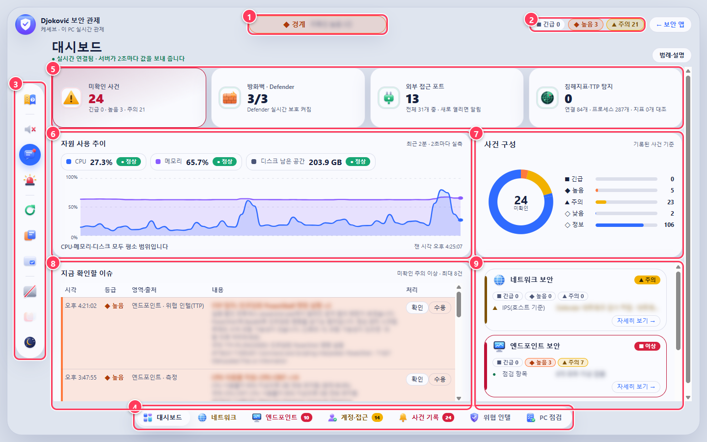

1. **전체 상태**: 지금 가장 심각한 문제 하나를 색과 글로 알려 줍니다. 초록은 정상, 노랑은 주의, 빨강은 위험, 회색은 확인할 수 없음입니다.
2. **미확인 사건 수**: 아직 확인하지 않은 사건을 등급별로 셉니다. 사건을 확인하면 숫자가 줄어듭니다.
3. **도구 막대**: 소리, 알림, 시험 경보, 배치 편집 같은 도구 버튼이 모여 있습니다. 다음 장에서 하나씩 설명합니다.
4. **탭 막대**: 네트워크, 엔드포인트, 계정·접근, 사건 기록, 위협 인텔 화면으로 바꿉니다. 탭 위 숫자는 그 영역의 미확인 사건 수입니다.
5. **현황 수치**: 미확인 사건, 방화벽·Defender 상태, 밖에서 접속할 수 있는 포트 수, 탐지 건수를 숫자로 보여 줍니다.
6. **자원 사용 추이**: CPU와 메모리를 2초마다 잽니다. 평소보다 갑자기 오르거나 높은 상태가 이어지면 아래 줄에 이유가 나옵니다.
7. **사건 구성**: 쌓인 사건이 어떤 등급으로 이루어져 있는지 비율로 보여 줍니다.
8. **지금 확인할 이슈**: 주의 등급 이상이면서 아직 확인하지 않은 사건을 최대 8건 띄웁니다. 「확인」을 누르면 목록에서 빠집니다.
9. **보안 영역 요약**: 네트워크·엔드포인트·계정 세 영역의 상태입니다. 「자세히 보기」를 누르면 그 탭으로 갑니다.

> 회색 「확인 불가」는 문제가 없다는 뜻이 아닙니다. 값을 읽지 못했거나 이 앱이 보지 않는 항목이라는 뜻입니다.

## 2. 왼쪽 도구 막대

버튼에 마우스를 올리면 이름이 뜹니다. 그림은 이름을 모두 펼쳐 놓고 찍은 것입니다.

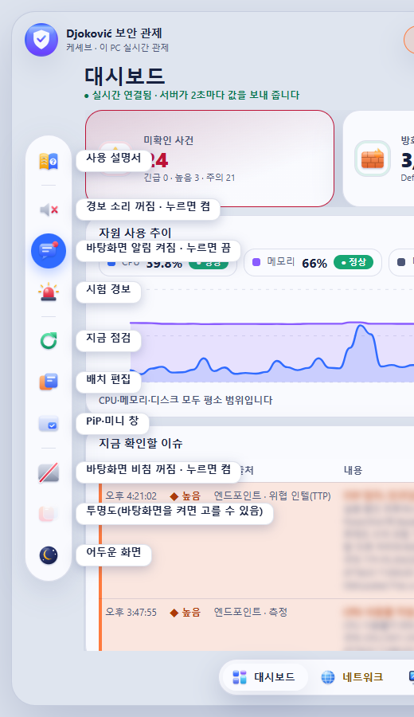

- **사용 설명서**: 지금 보고 있는 이 설명서를 다시 엽니다.
- **경보 소리**: 켜 두면 긴급 경보가 뜰 때 삐 소리가 납니다. 한 번 더 누르면 꺼집니다.
- **바탕화면 알림**: 긴급 사건을 Windows 알림으로도 띄웁니다. 처음 켤 때 브라우저가 허용할지 묻습니다. 켜짐·꺼짐 아이콘이 다르고, 누를 때마다 바뀝니다.
- **시험 경보**: 경보 화면, 소리, 알림이 제대로 뜨는지 확인하는 버튼입니다. 「시험」 표시가 붙고 실제 사건이 아닙니다.
- **지금 점검**: 방화벽, Defender, 포트, 계정 상태를 60초 주기를 기다리지 않고 바로 다시 읽습니다.
- **배치 편집**: 대시보드 위젯의 위치와 크기를 바꾸고 프리셋으로 저장합니다.
- **PiP·미니 창**: 다른 프로그램 위에 떠 있는 작은 관제 창을 엽니다.
- **바탕화면 비침**: 화면 뒤로 바탕화면 그림이 비치게 하거나 끕니다. 옆 버튼으로 투명한 정도를 고릅니다.
- **어두운 화면**: 밝은 화면과 어두운 화면을 바꿉니다.

> 배치 편집에서 도구 막대를 오른쪽이나 위로 옮길 수 있습니다.

## 3. 네트워크 탭

방화벽, 열린 포트, VPN처럼 이 PC가 네트워크와 만나는 지점을 봅니다.

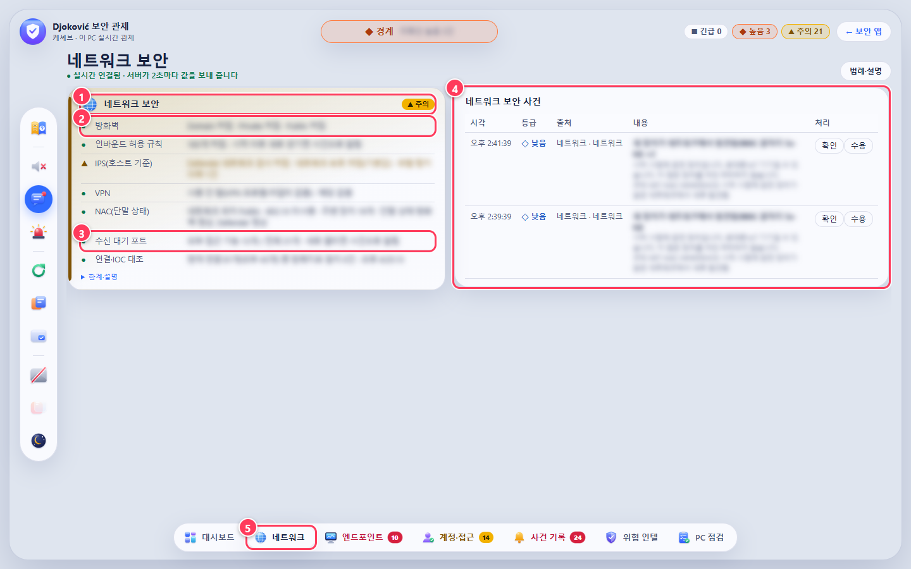

1. **영역 상태**: 이 영역에서 가장 나쁜 항목의 등급이 오른쪽 위 칩에 나옵니다.
2. **방화벽**: 도메인·개인·공용 프로필별로 켜져 있는지 봅니다. 모두 꺼지면 긴급 사건이 됩니다.
3. **수신 대기 포트**: 밖에서 접속할 수 있는 포트 수입니다. 앱을 켠 뒤 새로 열리면 사건으로 알립니다.
4. **영역 사건**: 네트워크 영역에서 생긴 사건만 모아 보여 줍니다.
5. **탭 배지**: 이 영역의 미확인 사건 수입니다. 다른 탭에 있어도 숫자로 알 수 있습니다.

> IPS·NAC는 원래 네트워크 장비가 하는 일입니다. 이 앱은 PC가 보고하는 상태만 읽고, 차단은 하지 않습니다.

## 4. 엔드포인트 탭

PC 안쪽을 봅니다. 백신, 설치 프로그램, 예약 작업, USB, 중요한 폴더의 변경이 여기 모입니다.

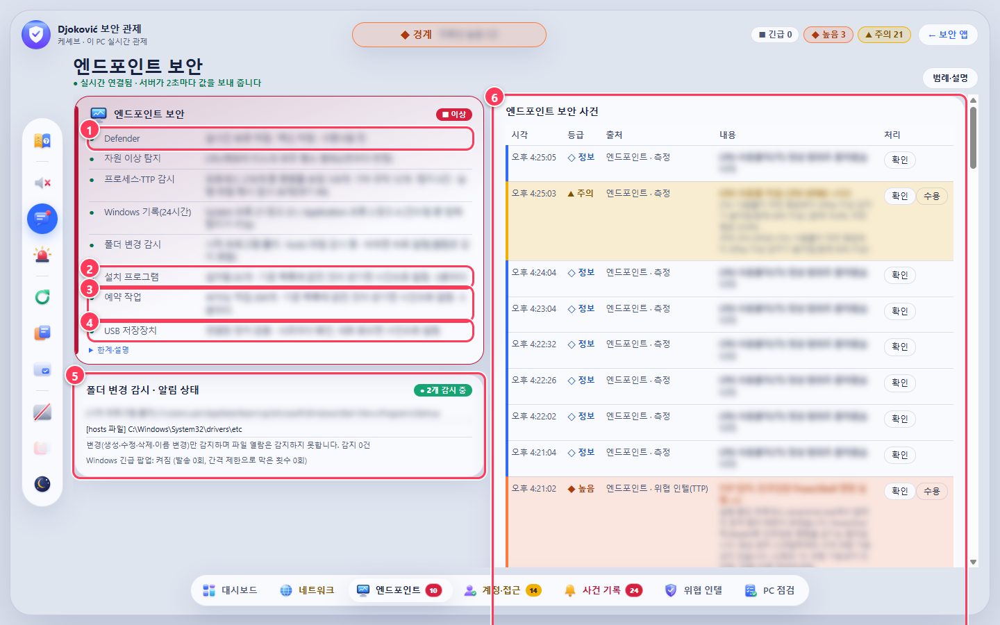

1. **Defender**: 실시간 보호와 백신이 켜져 있는지, 서명이 며칠 전 것인지 봅니다.
2. **설치 프로그램**: 5분마다 설치 목록을 기준 목록과 비교합니다. 없던 프로그램이 생기면 주의 사건을 올립니다. 버전만 바뀐 업데이트는 알리지 않습니다.
3. **예약 작업**: 새 예약 작업이 생기거나 실행 대상이 바뀌면 알립니다. PowerShell·cmd·mshta 같은 스크립트 실행기를 부르는 작업은 높음 등급입니다.
4. **USB 저장장치**: 15초마다 확인합니다. 새로 꽂으면 주의 사건, 빼면 정보 기록이 남습니다. 장치 일련번호는 화면에 내보내지 않습니다.
5. **폴더 변경 감시**: 시작 프로그램 폴더, hosts 파일, .ssh 같은 열쇠 폴더가 바뀌면 바로 알립니다. 파일을 열어 보기만 한 것은 Windows가 알려 주지 않아 잡지 못합니다.
6. **영역 사건**: 엔드포인트 영역의 사건만 모아 보여 줍니다.

> 처음 켠 날은 지금 있는 프로그램과 예약 작업을 기준 목록으로 저장만 하고 알리지 않습니다. 그 뒤로는 서버가 꺼져 있던 동안 생긴 것도 다음에 켤 때 알립니다.

## 5. 계정·접근 탭

로컬 계정 설정과 AI 에이전트가 어떤 파일에 손대는지를 봅니다.

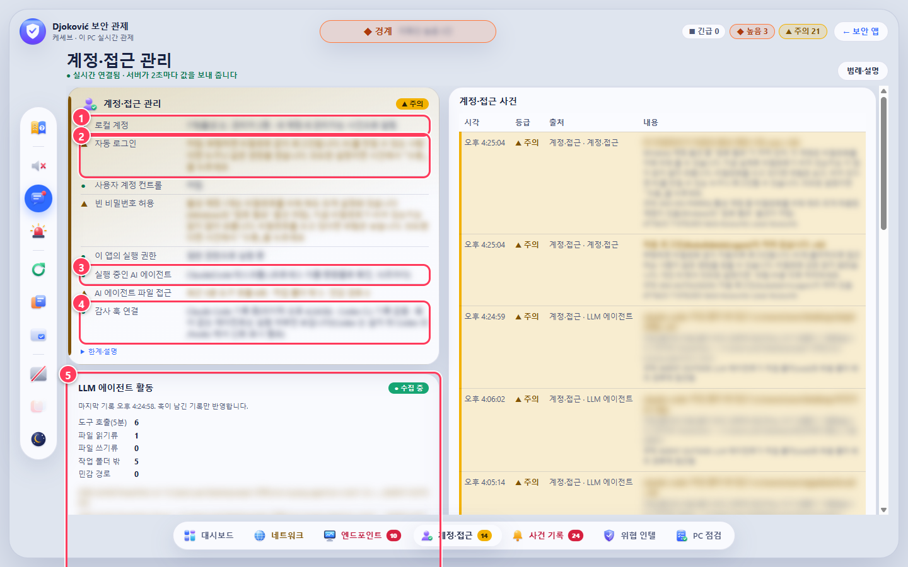

1. **로컬 계정**: 계정 수, 관리자 수를 봅니다. 새 계정이나 새 관리자가 생기면 사건으로 알립니다.
2. **자동 로그인 같은 설정**: 위험할 수 있는 설정에는 노란 표시가 붙습니다. 일부러 그렇게 쓰는 것이면 사건에서 「수용」을 누르세요. 그 뒤로는 「수용함」으로 바뀝니다.
3. **실행 중인 AI 에이전트**: Claude, Codex 같은 에이전트가 지금 실행 중인지 프로그램 이름으로 확인합니다.
4. **감사 훅 연결**: 에이전트별로 파일 접근 기록이 들어오고 있는지 보여 줍니다. Claude Code와 Codex CLI를 지원합니다. 새 PC에서는 아래 「LLM 에이전트 활동」 칸의 「이 PC에 감시 연결」을 한 번 누르세요.
5. **AI 에이전트 활동**: 최근 5분 동안의 도구 호출, 작업 폴더 밖 접근, 민감한 경로(.ssh, .env, 브라우저 저장소 등) 접근을 셉니다.

> Codex는 훅을 설치한 뒤 Codex를 열고 /hooks 화면에서 이 훅을 신뢰로 한 번 표시해야 기록이 시작됩니다.

## 6. 사건 기록 탭

규칙에 걸린 모든 사건이 최신순으로 쌓입니다. 서버를 다시 켜도 지난 사건이 남아 있습니다.

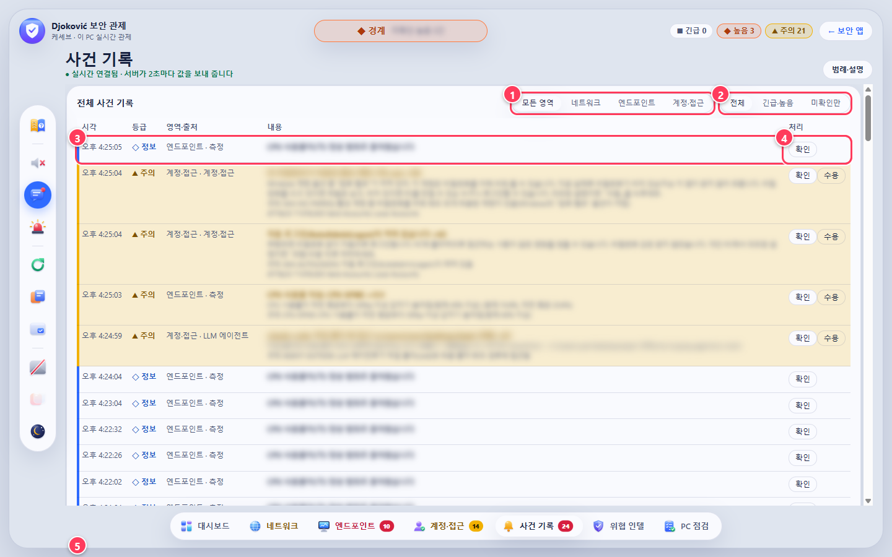

1. **영역 필터**: 네트워크, 엔드포인트, 계정·접근 중 하나만 골라 봅니다.
2. **등급·상태 필터**: 「긴급·높음」이나 「미확인만」으로 좁혀 봅니다.
3. **사건 한 줄**: 시각, 등급, 출처, 내용, 걸린 규칙을 보여 줍니다. 같은 사건이 반복되면 새 줄을 만들지 않고 ×N으로 횟수만 늘립니다. 오늘이 아닌 사건에는 날짜가 붙습니다.
4. **처리 버튼**: 「확인」은 봤다는 표시입니다. 「수용」은 오탐이거나 알고 받아들이는 상태라는 뜻이라 같은 사건을 더 올리지 않습니다.
5. **보관 상태**: 사건은 이 PC에 30일, 최대 2000건까지 남습니다. 저장 위치와 마지막 저장 시각이 여기 나옵니다.

> 사건 기록 파일은 저장소 밖(%LOCALAPPDATA%\djokovic-soc\events.json)에 있어 Git에 올라가지 않습니다.

## 7. 위협 인텔 탭

알려진 나쁜 주소·파일·프로그램 목록과 공격 수법을 내 PC의 연결, 실행 중인 프로그램과 계속 맞춰 보는 곳입니다.

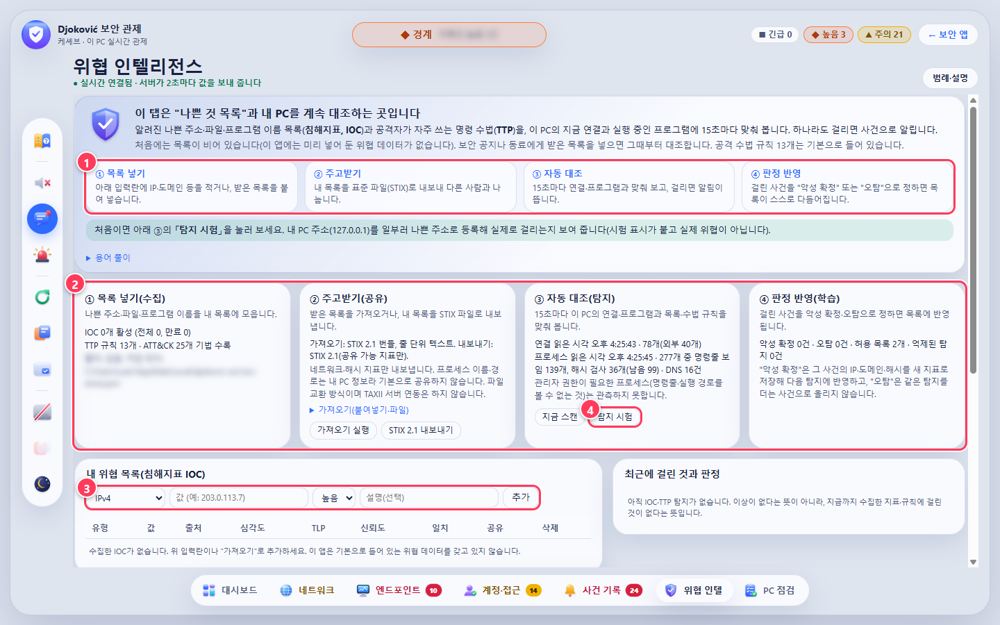

1. **네 단계**: 목록 넣기, 주고받기, 자동 대조, 판정 반영 순서로 돌아갑니다.
2. **처리 흐름**: 단계마다 지금 몇 개를 처리했는지 보여 줍니다. 마지막으로 연결·프로그램을 읽은 시각도 여기 나옵니다.
3. **목록 추가**: IP, 도메인, 파일 지문(SHA-256), 프로그램 이름을 적어 넣습니다. 받은 목록은 ② 칸의 「가져오기 실행」으로 한꺼번에 넣습니다.
4. **탐지 시험**: 내 PC 주소(127.0.0.1)를 일부러 나쁜 주소로 등록해 실제로 걸리는지 보여 줍니다. 「시험」 표시가 붙고 실제 위협이 아닙니다.
- **공격 수법 범위(화면 아래쪽)**: MITRE ATT&CK 사전에서 이 앱이 감시하는 기법(●)과 아직 못 보는 기법(○)을 나눠 보여 줍니다.

> 처음에는 목록이 비어 있습니다. 이 앱은 미리 넣어 둔 위협 데이터를 갖고 있지 않습니다.

## 8. PC 보안 점검(KISA PC-01~18)

수업 워크시트의 18개 항목을 이 PC에서 자동으로 검사합니다. 탭을 처음 열면 저절로 한 번 검사하고, 설정은 읽기만 합니다.

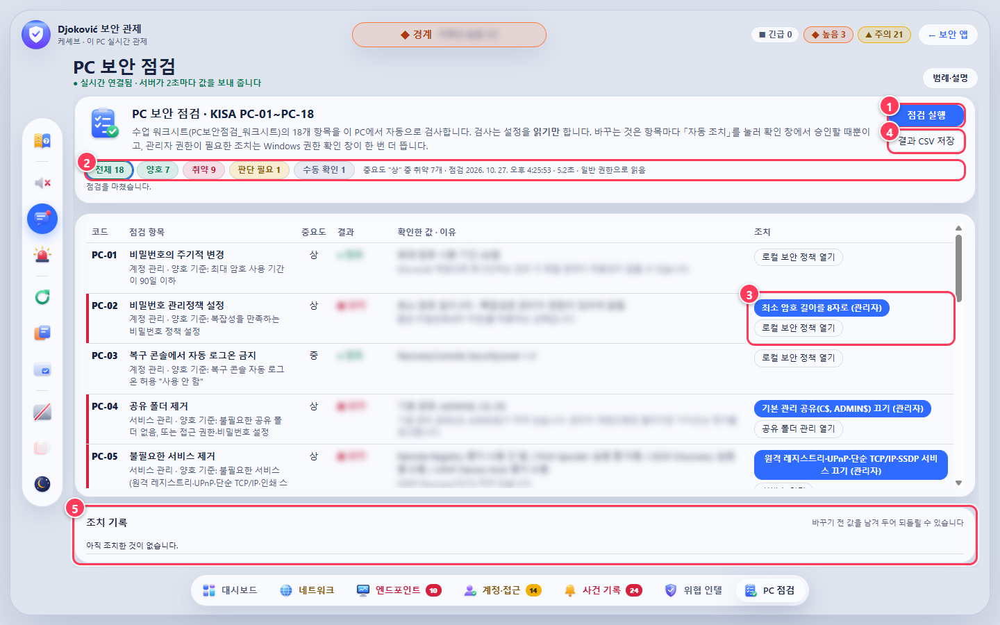

1. **점검 실행**: 다시 검사합니다. 보통 5~10초 걸립니다.
2. **결과 요약**: 양호·취약·판단 필요·수동 확인 개수입니다. 누르면 그 결과만 골라 봅니다. "수동 확인"은 관리자 권한이 있어야 읽히는 항목이라 직접 확인해야 한다는 뜻입니다.
3. **자동 조치**: 취약한 항목에 붙는 버튼입니다. 누르면 무엇을 바꾸는지, 실제로 실행할 명령, 되돌릴 수 있는지를 보여 주는 확인 창이 뜹니다. 관리자 권한이 필요한 조치는 Windows 권한 확인 창에서 「예」를 눌러야 바뀝니다.
4. **결과 CSV 저장**: 워크시트 「점검표」의 자동 판정 칸에 옮겨 적기 좋은 CSV로 저장합니다.
5. **조치 기록**: 바꾼 것과 바꾸기 전 값이 남습니다. 「되돌리기」로 원래대로 돌릴 수 있습니다.
- **설정 열기**: 항목마다 관련 Windows 설정 화면을 여는 버튼도 있습니다. 화면만 열고 아무것도 바꾸지 않습니다.

> 워크시트 규칙대로 조치는 되돌리는 방법을 먼저 확인하고, 강사가 안내한 항목만 하세요. 회사 PC는 사내 보안 정책이 우선입니다.

## 9. 긴급 경보가 뜨면

긴급 등급 사건이 생기면 화면 전체를 덮는 경보 창이 뜹니다. 높음·주의 사건은 오른쪽 위에 작은 알림으로 잠깐 떴다 사라집니다.

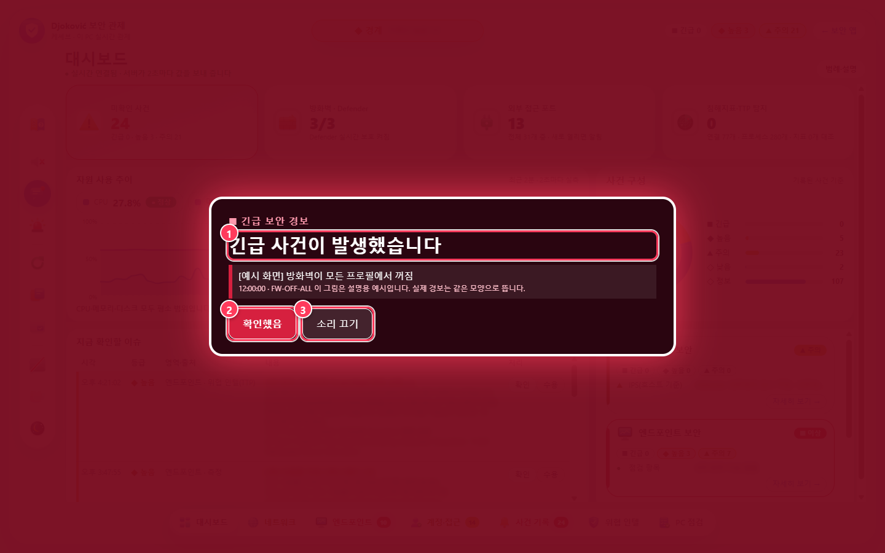

*설명을 위해 띄운 예시 화면입니다. 실제 긴급 경보도 같은 모양입니다.*

1. **무슨 일인지**: 어떤 사건인지, 어떤 규칙에 걸렸는지 적혀 있습니다.
2. **확인했음**: 눌러야 경보 창이 닫힙니다. 누를 때까지 창, 소리, 제목 깜빡임이 이어집니다.
3. **소리 끄기**: 확인하기 전에 소리만 끕니다.

> 처음 쓸 때 「시험 경보」를 한 번 눌러 소리와 알림이 제대로 나오는지 확인해 두세요.

## 10. 배치 바꾸기와 프리셋

도구 막대의 「배치 편집」을 누르면 대시보드를 내 마음대로 꾸밀 수 있습니다.

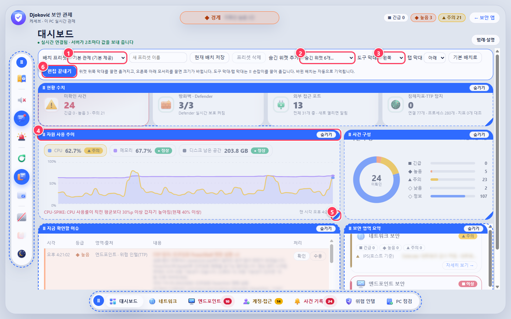

1. **프리셋**: 저장해 둔 배치를 고릅니다. 지금 배치를 이름 붙여 저장하거나 지울 수 있습니다.
2. **숨긴 위젯 추가**: 영역 상세, 전체 사건, 위협 인텔 요약, AI 에이전트 활동 같은 위젯을 판에 꺼냅니다.
3. **막대 위치**: 도구 막대(왼쪽·오른쪽·위)와 탭 막대(아래·위) 자리를 바꿉니다.
4. **옮기기**: 위젯 위쪽 막대를 끌어 다른 칸으로 옮깁니다.
5. **크기 바꾸기**: 오른쪽 아래 모서리를 끌어 크기를 바꿉니다.
6. **편집 끝내기**: 편집을 마칩니다. 배치는 자동으로 저장됩니다.

> 「기본 배치로」를 누르면 처음 배치로 돌아갑니다.

## 11. PiP 창에 띄울 정보 고르기

도구 막대의 「PiP·미니 창」을 누르면 오른쪽에 설정 서랍이 열립니다.

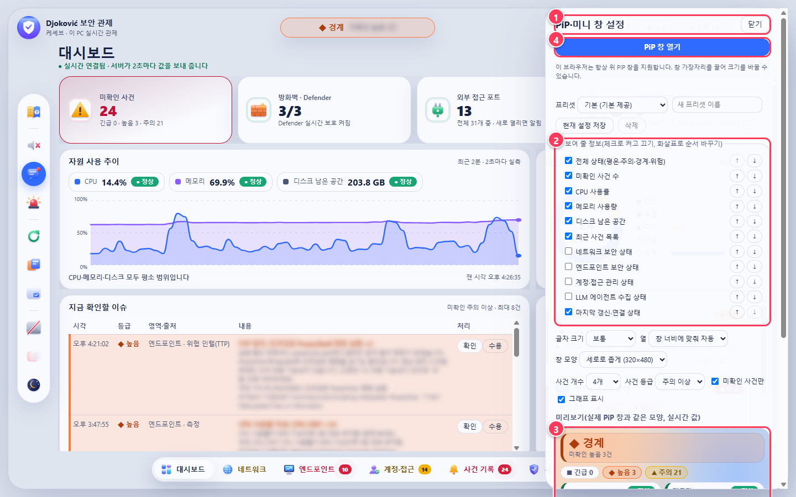

1. **서랍 머리**: 설정 서랍의 제목과 닫기 버튼이 있습니다.
2. **보여 줄 항목**: 전체 상태, CPU, 메모리, 최근 사건처럼 작은 창에 넣을 정보를 고르고 순서를 바꿉니다.
3. **미리보기**: 고른 대로 작은 창이 어떻게 보일지 바로 보여 줍니다.
4. **PiP 창 열기**: 브라우저의 PiP 창으로 띄웁니다. 브라우저가 지원하지 않으면 작은 팝업 창으로 엽니다.

> 브라우저 PiP 창은 위쪽 제목 막대를 없앨 수 없습니다. 막대 없는 창은 다음 장의 데스크톱 미니 창을 쓰세요.

## 12. 막대 없는 데스크톱 미니 창

제목 막대와 주소 막대가 없는 작은 창이 항상 다른 창 위에 떠 있습니다. 전체 화면 앱 위에도 뜹니다.

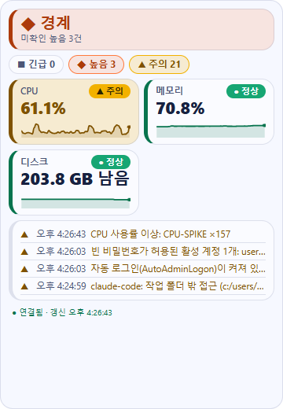

*미니 창을 그대로 찍은 모습(실제 크기 360×520)*

- **켜는 법**: 앱 폴더에서 PowerShell로 tools\start-pip.ps1 을 실행합니다. 처음 한 번은 -Install 을 붙여 실행 도구(Electron)를 설치합니다.
- **옮기기·크기**: 판 아무 곳이나 끌면 창이 옮겨지고, 가장자리를 끌면 크기가 바뀝니다. 위치와 크기는 기억합니다.
- **투명도·닫기**: 위쪽에 마우스를 올리면 「◐−」「◐+」 투명도 버튼과 「✕」 닫기 버튼이 나옵니다.
- **보여 줄 정보**: 앞 장의 PiP 설정을 그대로 따릅니다.

> 관제 서버가 꺼져 있으면 안내를 띄우고 5초마다 다시 연결합니다.

## 13. 자동 실행과 감시 연결

한 번만 해 두면 되는 설정입니다. 모두 앱 폴더(on-client)의 PowerShell에서 실행하고, 관리자 권한은 필요 없습니다.

- **데스크톱 앱**: 설치 파일을 실행하면 먼저 설치 비밀번호를 묻습니다. 「Djokovic 보안 관제」 앱을 설치하면 관제 서버가 앱 안에서 함께 켜지고, 로그인할 때 자동으로 시작합니다(작업 표시줄 오른쪽 알림 영역 아이콘 메뉴에서 끌 수 있음). 창을 닫아도 알림 영역에서 감시가 계속되며, 아이콘 색이 초록·노랑·빨강으로 상태를 알려 줍니다.
- **업데이트**: 앱이 하루에 몇 번 새 버전을 확인해 알림을 띄웁니다. 알림 영역 아이콘 메뉴의 「업데이트 설치」를 누르면 받아서 설치합니다(설치 비밀번호 필요). 사건 기록과 설정은 그대로 남습니다.
- **지우기**: 설정 > 앱 > 설치된 앱, 또는 알림 영역 아이콘 메뉴의 「프로그램 제거…」로 제거 마법사를 엽니다. 사건 기록까지 지울지 고를 수 있습니다(기본은 남김).
- **앱 없이 자동 실행**: powershell -NoProfile -ExecutionPolicy Bypass -File .\tools\autostart.ps1 -Enable  앱을 설치하지 않았을 때 쓰는 방법입니다. 앱과 함께 켜 두면 서버가 겹치므로 둘 중 하나만 쓰세요. 끄려면 -Disable.
- **Codex 감시 연결**: powershell -NoProfile -ExecutionPolicy Bypass -File .\tools\install-agent-hooks.ps1  그다음 Codex를 열고 /hooks 에서 이 훅을 신뢰로 표시합니다. 지우려면 -Uninstall.
- **Claude Code 감시**: Claude Code 설정(settings.json)의 PreToolUse 훅에 tools\agent-audit-hook.mjs 를 연결합니다. 이 PC에는 이미 연결돼 있습니다.
- **남는 파일**: %LOCALAPPDATA%\djokovic-soc 폴더에 사건 기록(events.json), 프로그램·예약 작업 기준 목록, 에이전트 감사 기록, 위협 목록이 남습니다. 폴더를 지우면 모두 처음부터 다시 시작합니다.

> 자동 실행을 켜거나 끄면 시작 프로그램 폴더가 바뀌므로 「시작 프로그램 폴더 변경」 알림이 한 번 뜹니다. 직접 한 것이면 「수용」을 누르면 됩니다.
