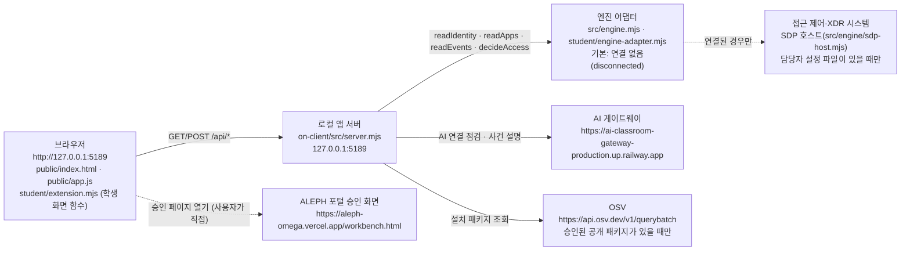

# 학생용 실행 설명서와 시스템 구성도 (Djoković 보안 Agent)

이 문서는 학생(저장소 소유자)이 `on-client` 폴더를 직접 실행하고 확인하며 쓴 설명서입니다. 제공된 `README.md`는 그대로 두었고, 이 문서는 그 옆에 추가한 학생 문서입니다.

## 0. 문서 읽는 법: 확인 구분

각 항목 끝의 표시는 실제로 무엇을 했는지를 뜻합니다. 표시가 없는 문장은 코드를 읽고 쓴 설명입니다.

| 표시 | 뜻 |
|---|---|
| [코드 확인] | 파일을 읽고 확인했습니다. 실행하지 않았습니다. |
| [모의 점검] | 가짜 DOM과 모의 입력으로 학생 함수를 호출해 확인했습니다. 실제 화면이 아닙니다. |
| [PC 실행 확인] | 2026-10-26에 이 PC에서 실행하고 결과를 관찰했습니다. 학생의 요청으로 AI 코딩 도구가 같은 PC에서 실행하고 화면을 읽은 것이며, 학생이 직접 입력해 따라 한 것은 아닙니다. |
| [미확인] | 실행하지 않았거나 환경이 없어 확인하지 못했습니다. 동작한다고 쓰지 않습니다. |

## 1. 목적과 기능

회사 직원이 자기 로그인 상태, 업무 앱 접속 판정, 최근 접속 기록과 보안 경보를 보는 로컬 웹 앱입니다. 화면 8곳은 제가 `student/extension.mjs`에 구현한 함수가 그립니다. 나머지(서버, HTML, 연결 절차)는 시작 틀이 제공한 코드입니다.

## 2. 필요한 프로그램과 확인한 버전

| 프로그램 | 이 PC에서 확인한 버전 | 요구·허용 범위 |
|---|---|---|
| Windows | Windows 11 Pro 10.0.26100 | `tools\start-alekov.ps1`이 Windows 경로 검사를 포함하므로 Windows 기준입니다. |
| Node.js | v24.21.0 [PC 실행 확인] | `package.json`의 `engines`는 24.19.0입니다. 실행 도구는 22~24를 허용하고 24.19.0이 아니면 "수업 기준은 v24.19.0" 참고 문구를 냅니다. 21 이하나 25 이상은 거부합니다. [코드 확인] |
| npm | 11.19.0 [PC 실행 확인] | 외부 npm 의존성이 없어 `npm install`은 필요 없습니다. `package.json`에 `dependencies`가 없습니다. [코드 확인] |
| Git | 2.55.0.windows.3 [PC 실행 확인] | 커밋과 제출에만 씁니다. 앱 실행에는 필요 없습니다. |
| Windows PowerShell | 5.1.26100.9711 [PC 실행 확인] | 실행 도구는 Windows PowerShell에서 `-File`로 실행합니다. PowerShell 7은 쓰지 않았습니다. [미확인] |
| 브라우저 | PC의 Chromium 계열 브라우저. 버전은 기록하지 않았습니다. | 지원 브라우저 목록은 확인하지 않았습니다. [미확인] |

지원하지 않거나 확인하지 않은 환경: macOS, Linux, Node.js 21 이하·25 이상(실행 도구가 거부), PowerShell 7. 이 환경들은 실행해 보지 않았으므로 동작한다고 쓰지 않습니다.

## 3. 폴더 구조

Git 최상위 폴더는 `choi-bujang-agent`이고 앱 폴더는 그 안의 `on-client`입니다. 저장소를 받은 위치는 어디든 상관없고, 문서에서는 그 폴더를 `<저장소 폴더>`로 씁니다. 코드와 설정에 PC 고유의 절대 경로를 쓰지 않습니다(`on-client` 안의 경로는 모두 실행 파일 위치 기준 상대 경로입니다). [코드 확인]

```text
choi-bujang-agent\                  Git 최상위(.gitignore: .env, .env.*, node_modules/)
└─ on-client\                       앱 폴더(여기서 실행)
   ├─ package.json                  scripts: start, demo, check
   ├─ .env.example                  비밀 없는 설정 견본
   ├─ README.md                     제공 README(수정하지 않고 끝에 학생 문서 안내만 추가)
   ├─ docs\STUDENT_RUNBOOK.md       이 문서
   ├─ tools\start-alekov.ps1        실행 도구(제공)
   ├─ src\server.mjs                로컬 앱 서버(제공)
   ├─ src\engine.mjs                엔진 어댑터 로더·예제 엔진(제공)
   ├─ src\ai\ , src\connection\     AI 연결·계정 연결(제공)
   ├─ src\actions\                  조치 준비·결과 서비스(제공)
   ├─ src\vulnerabilities\          설치 패키지·OSV 조회(제공)
   ├─ src\engine\                   SDP 호스트 연결(제공)
   ├─ public\                       index.html, app.js, style.css, vulnerabilities-view.mjs, assets(제공)
   ├─ vendor\clco-http.mjs          AI 게이트웨이 HTTP 클라이언트(제공)
   └─ student\
      ├─ extension.mjs              학생 구현(이 프로젝트에서 제가 작성)
      └─ engine-adapter.mjs         시작 틀 그대로(수정하지 않음)
```

위 구조는 실행용 전체본인 `step-21` 브랜치 기준입니다. 제출용 `submit-21` 브랜치에는 이 문서가 근거로 쓰는 파일(서버, 실행 도구, 설정 견본, 학생 코드, 화면 파일)만 남겼고 나머지 제공 파일은 `step-21`에서 볼 수 있습니다.

구조는 `find`로 폴더를 직접 나열해 확인했습니다. [PC 실행 확인] `README.md`가 언급하는 `docs\STUDENT_LAUNCH_GUIDE.md`, `docs\STUDENT_PROMPTS.md` 같은 시작 틀 문서는 이 저장소에 들어 있지 않습니다. `on-client\docs` 폴더에는 이 문서만 있습니다. [PC 실행 확인] 그 문서들을 읽고 따라 했다고 쓰지 않습니다.

## 4. 실행 절차

### 4-1. 실행

1. 새 PowerShell 창을 엽니다. 기존 작업 창은 닫지 않아도 됩니다.
2. 앱 폴더로 이동합니다. 경로에 공백과 한글이 있으므로 따옴표로 감쌉니다.

    cd "<저장소 폴더>\on-client"

3. 실행합니다.

    powershell -NoProfile -ExecutionPolicy Bypass -File .\tools\start-alekov.ps1

    다른 방법: `npm start`는 `node src/server.mjs`와 같은 서버를 켭니다. [코드 확인] 예제 자료로만 화면을 보려면 `npm run demo`(`node src/server.mjs --demo`)입니다. 예제 모드는 실제 연결이 아닙니다. 두 방법 모두 `npm` 명령 자체는 실행해 보지 않았습니다. [미확인] `npm start`가 켜는 것과 같은 `node src/server.mjs`는 직접 실행해 확인했습니다. [PC 실행 확인]

    실행 도구 옵션: `-Port 5190`(포트 변경), `-Background`(뒤에서 실행), `-Demo`(예제 모드). `-NativeHostConfig`, `-SdpHostConfig`는 담당자가 설정 파일을 줄 때만 씁니다. [코드 확인] `-Demo`와 `-SdpHostConfig`는 함께 쓸 수 없습니다. [코드 확인]

4. 브라우저에서 `http://127.0.0.1:5189`를 엽니다. 서버는 `127.0.0.1`에만 열리고, 요청의 Host가 `127.0.0.1:5189` 또는 `localhost:5189`가 아니면 거부합니다(`HOST_REJECTED`, 403). [코드 확인]

### 4-2. 정상 시작 신호

| 신호 | 확인 구분 |
|---|---|
| 서버 콘솔에 `케셰브 연결 확인: http://127.0.0.1:5189` 한 줄이 출력됨(예제 모드는 `케셰브 예제: ...`) | [PC 실행 확인] `node src/server.mjs`를 직접 실행해 이 한 줄을 관찰했습니다. |
| 실행 도구가 서버의 `/` 응답이 200일 때까지 최대 20초 기다린 뒤 "케셰브가 켜졌습니다. 브라우저에서 ... 을 여세요."를 출력함 | [PC 실행 확인] 22단계 재현에서 표준 출력을 파일로 받아 이 문구와 "서버가 응답한 것만 확인했습니다..."를 직접 확인했습니다(`docs/REPRODUCTION_RECORD.md` 4절). 21단계 작성 시점에는 `-Background` 실행만 해서 문구를 보지 못했고 `GET /` 200(17136바이트)만 관찰했습니다. |
| 브라우저 제목이 `케셰브 · ZTNA & XDR`, 화면에 `연결 없음` 표시 | [PC 실행 확인] |

이 신호는 서버가 응답한다는 뜻일 뿐 AI 연결 성공이나 실제 회사 시스템 연결을 뜻하지 않습니다. 실행 도구도 같은 문구를 출력합니다. [코드 확인]

### 4-3. 종료와 재실행

- 종료: 일반 실행은 그 창에서 `Ctrl+C`를 누릅니다. `-Background`로 실행했다면 출력된 프로세스 번호의 `node`를 작업 관리자나 `Stop-Process -Id 번호`로 종료합니다. 종료 뒤 5189 포트를 쓰는 프로세스가 없는 것을 확인했습니다. [PC 실행 확인] `Ctrl+C` 종료는 직접 눌러 확인하지 않았습니다. [미확인]
- 재실행: 같은 명령을 다시 실행합니다. 5189가 사용 중이면 실행 도구가 다른 프로그램을 끄지 않고 "다른 번호로 실행해 주세요"라고 안내하므로 `-Port 5190`을 붙입니다. [코드 확인] 이때 브라우저 주소도 `http://127.0.0.1:5190`으로 바꿉니다.
- `student/extension.mjs`만 고쳤다면 서버를 다시 켜지 않고 브라우저를 새로 고칩니다. 서버가 이 파일을 요청마다 디스크에서 읽고 `cache-control: no-store`로 보냅니다. [코드 확인] 수정 후 반영은 직접 해 보지 않았습니다. [미확인] `src/` 아래 서버 코드를 고쳤다면 서버를 다시 켭니다.
- 문법 검사: `npm run check`는 `node --check student/extension.mjs`만 실행하며 종료 코드 0을 확인했습니다. [PC 실행 확인] 동작 검사가 아닙니다.

### 4-4. 설정

`.env.example`은 비밀 없는 견본입니다. 서버에는 `.env` 파일을 자동으로 읽는 코드가 없습니다(`dotenv`와 `.env` 읽기 코드를 `src`, `tools`에서 검색해 없음을 확인). [코드 확인] 값을 쓰려면 PowerShell 세션의 환경 변수로 지정합니다. 실행 도구는 `TOKEN`, `SECRET`, `PASSWORD`, `API_KEY`, `ON_AI_`로 시작하는 이름 등 비밀로 보이는 환경 변수를 서버에 넘기지 않습니다. [코드 확인]

| 이름 | 견본 값 | 설명 |
|---|---|---|
| `ON_PORT` | `5189` | 서버 포트. 실행 도구의 `-Port`가 이 값을 설정합니다. |
| `ON_ENGINE_ADAPTER` | `./student/engine-adapter.mjs` | 엔진 어댑터 경로. 비어 있으면 연결 없음 상태입니다. |
| `ON_AI_MODEL` | `aleph/auto` | AI 모델. 원격 앱 정책의 허용 목록 확인이 필요합니다. |
| `ON_PROJECT_DIRECTORY` | (빈 값) | 설치 패키지 조회 대상 프로젝트 절대 경로. 운영자가 준비합니다. |
| `ON_APPROVED_PUBLIC_PACKAGES` | `[]` | 공개 조회를 승인한 npm 패키지 목록(JSON). 비어 있으면 OSV로 외부 조회하지 않습니다. |

열쇠, 토큰, 비밀번호는 코드, 커밋, 이 문서에 쓰지 않습니다. `.gitignore`가 `.env`와 `.env.*`를 제외하고 `.env.example`만 포함합니다. [코드 확인]

## 5. 시스템 구성도

### 5-1. Mermaid



### 5-2. 같은 내용을 글로 쓴 구성도

    [브라우저] --HTTP(127.0.0.1:5189)--> [로컬 앱 서버 src/server.mjs]
    [로컬 앱 서버] --> [엔진 어댑터] --(연결된 경우만)--> [접근 제어·XDR 시스템(SDP 호스트)]
    [로컬 앱 서버] --HTTPS--> [AI 게이트웨이]        (AI 연결 점검, 사건 설명)
    [로컬 앱 서버] --HTTPS--> [OSV querybatch]        (승인된 공개 패키지가 있을 때만)
    [브라우저] --(사용자가 직접 여는 링크)--> [ALEPH 포털 승인 화면]
    학생 화면 함수는 브라우저 안에서 /student/extension.mjs를 읽어 8개 칸을 그림

### 5-3. 관계 표

| 출발 | 도착 | 경로·주소 | 내용 | 확인 구분 |
|---|---|---|---|---|
| 브라우저 | 로컬 앱 서버 | `GET /api/me`, `/api/apps`, `/api/events`, `/api/devices`, `/api/sessions` | 본인 신원·앱·기록·기기·세션 조회 | [코드 확인] 기본 실행에서 `/api/me`, `/api/events`는 503 `ENGINE_NOT_CONNECTED`를 관찰 [PC 실행 확인] |
| 브라우저 | 로컬 앱 서버 | `POST /api/access` | 업무 앱 접근 판정 요청 | [코드 확인] |
| 브라우저 | 로컬 앱 서버 | `GET /api/vulnerabilities`, `GET /api/diagnostics` | 설치 패키지 조회, 도움정보 | 둘 다 200 관찰 [PC 실행 확인] |
| 브라우저 | 로컬 앱 서버 | `POST /api/ai/connect/{start,finish,status,cancel}`, `POST /api/ai/check`, `POST /api/ai/explain` | AI 연결 절차, 점검, 사건 설명 | [코드 확인] [미확인] 실제 호출하지 않았습니다. |
| 브라우저 | 로컬 앱 서버 | `POST /api/native-login/{start,status,redeem,current,cancel}` | 계정 연결 확인 | [코드 확인] 호스트 연결이 없으면 `NATIVE_HOST_DISABLED`(503)로 응답하는 코드가 있습니다. |
| 브라우저 | 로컬 앱 서버 | `POST /api/learner-support`, `POST /api/learner-support/gpt` | 제공된 학습 지원(문제 해결 안내) 기능. 학생 구현 범위가 아닙니다. | [코드 확인] [미확인] 호출하지 않았습니다. |
| 브라우저 | 로컬 앱 서버 | `POST /api/actions/{prepare,execute,result}` | 조치 준비·집행·결과 재조회 | [코드 확인] [미확인] 호출하지 않았습니다. |
| 로컬 앱 서버 | AI 게이트웨이 | `https://ai-classroom-gateway-production.up.railway.app` (`src/ai/connection.mjs`) | 모델 목록 점검, 사건 설명 | [코드 확인] [미확인] |
| 로컬 앱 서버 | OSV | `https://api.osv.dev/v1/querybatch` (`src/vulnerabilities/osv.mjs`) | 정확한 설치 버전의 취약점 ID 조회 | [코드 확인] 승인 목록이 비어 있어 외부 조회가 일어나지 않는 상태만 확인했습니다. [PC 실행 확인] |

### 5-4. 경계와 보호 장치

모두 `src/server.mjs`에서 확인했습니다. [코드 확인]

- 서버는 `127.0.0.1`에만 바인딩합니다.
- Host가 `127.0.0.1:포트` 또는 `localhost:포트`가 아니면 403 `HOST_REJECTED`입니다.
- 쿼리 문자열이 있는 요청은 400 `QUERY_REJECTED`입니다.
- `POST`는 `Origin`이 같은 주소가 아니면 403 `ORIGIN_REJECTED`입니다.
- 정적 파일 응답에는 `content-security-policy`(`default-src 'self'`)가 붙습니다.
- 브라우저가 엔진 모듈 경로를 고를 수 없습니다. 어댑터 경로는 서버 실행자의 설정입니다.

## 6. 구현한 함수와 제공 코드 경계

### 6-1. 학생이 구현한 함수 (`student/extension.mjs`)

| 함수 | 단계 | 화면 칸 | 하는 일 |
|---|---|---|---|
| `renderIdentity` | 13 | `student-identity` | 사용자·기기·세션 상태. 알 수 없는 값은 확인 불가로 표시하고 서버의 원래 상태 코드를 함께 적습니다. |
| `renderDecision` | 14 | `student-decision` | 접근 판정(`allow`, `deny`, `challenge`, `unknown`)과 이유. 요청 실패를 접근 거부로 쓰지 않습니다. |
| `renderEvents` | 15 | `student-events` | 접속·XDR 기록 목록, 종류·앱·접속 상태 필터, 상세. 새 자료가 오면 필터와 선택을 지웁니다. |
| `renderStatus` | 16 | `student-status` | 기기·세션·알림·진단 정보와 빈 상태·오류 구분. 도움정보 복사 버튼은 사용자가 누를 때만 복사합니다. |
| `renderAiConnection` | 17 | `student-ai-connection` | AI 연결 점검의 `idle`/`loading`/`ok`/`error`와 오류 원인 분류. 연결 점검 성공을 사건 설명 성공으로 쓰지 않습니다. |
| `renderExplanation` | 17~18 | `student-explanation` | AI 요약을 근거 ID·근거 글·규칙·확인 불가 상태·제안과 함께 표시. 근거 ID가 사건과 맞지 않으면 내용을 표시하지 않습니다. |
| `renderAction` | 19 | `student-action` | 제안·서버 접수(ACK)·효과 관측을 구분. `succeeded`는 `effectApplied === true`일 때만 효과 확인으로 씁니다. |
| `renderVulnerabilities` | 20 | `student-vulnerabilities` | 정확한 설치 버전과 OSV 결과, 미조회·일부 실패 구분. 범위(`^1.2.0`)는 설치 버전으로 표시하지 않습니다. |

`createStudentView()`가 위 함수를 묶어 내보냅니다. 시작 틀 시점(`d2fa991`) 대비 변경된 파일은 `on-client/student/extension.mjs` 하나였습니다(`git diff --name-only d2fa991 HEAD`). 이 문서와 README 추가분은 21단계에서 더했습니다. [PC 실행 확인]

### 6-2. 제공 코드 (수정하지 않음)

| 영역 | 파일 | 역할 |
|---|---|---|
| 서버 | `src/server.mjs`, `src/engine.mjs`, `src/engine/*` | 라우팅, 요청 검증, 엔진 어댑터 로더, SDP 호스트 연결 |
| AI | `src/ai/*`, `src/connection/*`, `vendor/clco-http.mjs` | 계정·AI 연결, 점검, 사건 설명 호출 |
| 조치 | `src/actions/*` | 조치 준비·집행·결과 재조회 서비스 |
| 취약점 | `src/vulnerabilities/*`, `public/vulnerabilities-view.mjs` | lock 파일 선별, OSV 조회, 제공 표 |
| 화면 | `public/index.html`, `public/app.js`, `public/style.css` | 제공 화면과 학생 함수 호출·상태 관리 |
| 실행 | `tools/start-alekov.ps1`, `tools/*.ps1` | 실행 도구 |
| 어댑터 틀 | `student/engine-adapter.mjs` | 연결 어댑터 틀. 수정하지 않아 기본 상태는 `disconnected`입니다. |

## 7. 화면 버튼 이름 (실제 `public/index.html` 기준)

2026-10-26에 서버를 켜고 화면의 버튼 문구를 직접 읽어 대조했습니다. [PC 실행 확인]

| 위치 | 버튼 |
|---|---|
| 상단 | 다시 불러오기, 보호 현황, 업무 앱, 보안 기록 |
| 도움정보 | 도움정보 불러오기, 확인했으며 복사합니다 |
| 계정 연결 확인 | 계정 연결 시작, 로그인 확인 완료, 현재 로그인 확인, 계정 연결 취소 |
| AI 연결 | AI 연결 시작, 승인했으며 연결 확인, 상태 다시 확인, 연결 취소, 현재 API 연결 점검(처음엔 숨김), 연결 도움정보 보기 |
| AI 연결 점검 | AI 연결 점검, AI 연결 점검 취소 |
| 설치 패키지 | 설치 패키지 조회, 패키지 조회 취소 |
| 사건 설명 | AI 설명 취소 |
| 조치 | 대상과 조치를 확인했으며 집행합니다, 원천 결과만 재조회, 조치 화면 취소 |

주의: 단계별 공식 안내 문장에는 「시작」「연결 확인」「연동 시스템 결과만 재조회」처럼 위 실제 화면과 다른 이름이 있습니다. 이 문서는 실제 화면의 이름을 씁니다. 19단계 `renderAction`의 재조회 안내 문구가 「연동 시스템 결과만 재조회」를 가리키는데 실제 버튼 이름은 「원천 결과만 재조회」입니다. 코드는 아직 고치지 않았습니다. 「조치 준비」 버튼은 AI 제안과 지원 조치가 있을 때만 생기며 지금은 보이지 않습니다. 이 버튼은 현재 화면에서 볼 수 없어 확인하지 못했습니다. [미확인]

## 8. 확인한 기능과 미확인 기능

| 기능 | 결과 | 확인 구분 |
|---|---|---|
| `npm run check`(학생 파일 문법) | 종료 코드 0 | [PC 실행 확인] |
| 서버 기동(`node src/server.mjs`) | 시작 신호 한 줄 출력, `GET /` 200 | [PC 실행 확인] |
| 실행 도구 `-Background` 기동 | 서버 프로세스 기동, `GET /` 200, 종료 후 포트 해제 | [PC 실행 확인] (도구가 출력한 안내 문구는 직접 보지 못함) |
| 연결 없음 기본 모드의 화면 | 학생 칸 8개가 의도한 문구를 표시: 사용자·기록은 연결 실패 문구, AI 연결은 "AI 연결 점검 전", 설명은 "보안 기록에서 기록을 먼저 고르세요", 조치는 "아직 미실행(idle)", 패키지는 "조회 전" | [PC 실행 확인] |
| 브라우저 콘솔 | 503 응답 오류 5건(연결 어댑터가 없어 정상). 다른 오류는 보지 못함 | [PC 실행 확인] |
| 설치 패키지 조회 버튼 | 200, 제공 표와 학생 칸 모두 `not_configured`(조회 준비 미완료), 패키지 0행, "취약점 없음이 아닙니다" 문구 | [PC 실행 확인] |
| 18~20단계 학생 함수의 상태별 표시 | 상태별 모의 입력 22개(18단계), 23개(19단계), 26개(20단계) 통과 | [모의 점검] 실제 화면이 아닙니다. |
| 13~17단계 학생 함수의 모의 입력 점검 | 22단계 재현에서 새 폴더 코드로 27개 점검 통과(`docs/REPRODUCTION_RECORD.md` 5절). 21단계 작성 시점에는 하지 않았습니다. | [모의 점검] |
| 실제 회사 시스템(SDP) 연결, 계정 연결 확인 | 호스트 설정이 없어 시도하지 않았습니다. | [미확인] |
| AI 연결 점검·사건 설명 실제 호출 | 유료 요청이 될 수 있어 누르지 않았습니다. | [미확인] |
| 조치 준비·집행·결과 재조회 | 지원 조치가 없어 경로가 열리지 않습니다. 실제 학생 계정의 조치 처리 결과는 기다림(UNV)입니다. | [미확인] |
| OSV 실제 조회(`complete`, `partial`) | 허용 패키지 목록이 비어 있어 외부 조회가 일어나지 않았습니다. | [미확인] |
| 예제 모드(`npm run demo`, `-Demo`) | 실행하지 않았습니다. | [미확인] |
| 같은 PC의 새 빈 폴더에서 같은 커밋 재현 | 22단계에서 했습니다. 결과는 `docs/REPRODUCTION_RECORD.md`에 있습니다. | [PC 실행 확인] |
| 다른 PC·다른 계정에서의 재현 | 하지 않았습니다. | [미확인] |
| 서버 AI 판정 결과 | 이 문서는 판정 결과를 기록하지 않습니다. | [미확인] |

## 9. 오류별 확인 순서

| 증상 | 확인 순서 | 근거 |
|---|---|---|
| "앱 폴더가 아닙니다" 또는 "바로가기(링크)로 연결된 폴더...에서는 실행하지 않습니다" | 1) PowerShell의 현재 폴더가 `on-client`인지 확인 2) `tools\start-alekov.ps1`, `src\server.mjs`, `package.json` 존재 확인 3) 링크로 연결한 폴더가 아닌 실제 폴더에서 실행 | [코드 확인] |
| "Node.js 가 없습니다" / "Node.js 22~24 에서 실행합니다" | 새 PowerShell 창에서 `node --version` 실행. 22~24가 아니면 Node.js 24.19.0 설치 후 새 창에서 재실행 | [코드 확인] |
| "포트 5189 를 다른 프로그램이 쓰고 있습니다" | 다른 프로그램은 끄지 말고 `-Port 5190`으로 실행하고 브라우저 주소의 포트도 바꿈 | [코드 확인] |
| "앱 서버가 20 초 안에 뜨지 않았습니다" | 같은 창의 메시지 확인 → `node src/server.mjs`를 직접 실행해 오류 문구 확인 → 담당 강사에게 메시지 전달 | [코드 확인] 직접 실행 확인 방법은 실행 도구가 같은 `server.mjs`를 켜는 구조라서 쓴 순서입니다. |
| 브라우저에서 403 `HOST_REJECTED` | 주소를 `http://127.0.0.1:5189` 또는 `http://localhost:5189`로 입력(다른 IP·호스트 이름 불가) | [코드 확인] |
| 화면에 "연결 없음", 콘솔에 503 오류, `ENGINE_NOT_CONNECTED` | 기본 실행의 정상 상태입니다. 서버 로그나 코드 오류가 아닙니다. 실제 연결은 담당자가 설정 파일을 줄 때 `-SdpHostConfig`로 지정합니다. | [PC 실행 확인] 연결 후 동작은 [미확인] |
| 설치 패키지 조회가 `not_configured` / `not_checked` | `ON_PROJECT_DIRECTORY`(대상 프로젝트)와 `ON_APPROVED_PUBLIC_PACKAGES`(허용 패키지)는 운영자가 준비합니다. 학생이 임의로 바꾸거나 의존성을 낮추지 않습니다. | [PC 실행 확인] `not_configured` |
| AI 연결 점검 실패 | 화면의 오류 코드로 원인을 나눕니다: 권한 준비 중(담당자에게 계정 연결·앱 권한 확인), 인증 실패·접근 제한(계정 연결 다시 확인), 한도(담당자 확인), 이용 시간 아님(시간 확인), 요청 제한·시간 초과·네트워크(잠시 뒤 직접 다시 점검), 취소(이전 결과는 현재 결과가 아님), 모델 없음(담당자에게 모델 허용 설정 확인). 자동으로 다시 점검하지 않습니다. | `renderAiConnection`의 오류 분류 [코드 확인] [모의 점검] |
| 사건 설명이 "근거가 맞지 않음" | AI 설명이 인용한 근거 ID가 선택한 사건의 근거 목록에 없는 경우입니다. 내용을 표시하지 않는 것이 정상입니다. 다른 사건을 고르거나 다시 요청합니다. | `renderExplanation` [모의 점검] |
| 조치 준비 버튼이 보이지 않음 | 사건의 `supportedActions`가 비어 있으면 정상입니다. | [코드 확인] [모의 점검] |
| `student/extension.mjs`를 고친 뒤 화면이 비어 있음 | `npm run check`로 문법 확인 → 브라우저 새로 고침 → 콘솔 오류 확인 | [PC 실행 확인] 문법 검사만 |

## 10. 지원하지 않는 것과 확인하지 않은 것

- 이 앱의 AI 설명과 제안은 참고 정보이며 보안 조치를 실행하지 않습니다.
- OSV는 알려진 취약점 데이터베이스입니다. 조회 결과가 없다는 사실만으로 패키지나 앱 전체가 안전하다고 보장하지 않습니다.
- 서버가 이 문서의 명령을 실행해 확인하지 않습니다. 실행 결과는 2026-10-26에 제가 이 PC에서 한 것만 [PC 실행 확인]으로 표시했습니다.
- 실제 SDP 연결, AI 호출, 조치 집행, 다른 환경에서의 재현은 확인하지 못했습니다.

## 11. 최종 앱 2일차: 내 PC 상태 (`/pc-status`)

> 알림: 이 문서가 설명하는 `/pc-status` 화면(「다시 조회」·「자동 조회」)은 마지막 총공세 제출 커밋(`99e73fa…`) 기준입니다. 그 뒤 커밋하지 않은 작업에서 이 화면은 실시간 보안 관제 화면으로 바뀌었습니다(`docs/SOC_GUIDE.md`). 제출 커밋의 화면을 확인하려면 그 커밋을 받아 실행하세요.

제공 서버(`src/server.mjs`), `public/*`, `student/*`는 수정하지 않았습니다. 새 진입 파일 `src/final-app.mjs`가 제공 서버의 `createOnServer()`를 그대로 불러 같은 포트에 `/pc-status` 화면과 `GET /api/pc-status`만 덧붙입니다. 그 밖의 모든 요청은 제공 서버가 처리합니다. [코드 확인]

### 11-1. 실행과 주소

    cd "<저장소 폴더>\on-client"
    powershell -NoProfile -ExecutionPolicy Bypass -File .\tools\start-final.ps1

- 보안 앱: `http://127.0.0.1:5189/`, 내 PC 상태: `http://127.0.0.1:5189/pc-status`
- 옵션: `-Port 5190`, `-Demo`(보안 앱을 예제 모드로), `-Background`. SDP·계정 연결 설정 옵션은 받지 않습니다(그 연결이 필요하면 기존 `start-alekov.ps1`을 씁니다). 이 진입 파일은 기본 실행과 `--demo`만 지원합니다. [코드 확인]
- 실행 도구 출력: "보안 앱: ...", "내 PC 상태: ..." 주소 두 줄과 "서버가 응답한 것만 확인했습니다..." [PC 실행 확인 2026-10-27]
- 종료: 그 창에서 `Ctrl+C`(직접 눌러 보지는 않음 [미확인]).

### 11-2. 측정 방법과 표시 규칙

| 값 | 방법(일반 권한, 읽기 전용) | 단위 | 읽지 못하면 |
|---|---|---|---|
| CPU 사용률 | `os.cpus()` 누적 시간을 직전 측정과 비교 | % | 첫 측정은 "확인 불가(첫 측정)". 간격이 너무 짧거나 값이 맞지 않아도 확인 불가 |
| 메모리 사용량 | `os.totalmem()` − `os.freemem()` | GB | 값이 올바르지 않으면 확인 불가 |
| 디스크 남은 공간 | `fs.statfsSync()`로 앱이 실행 중인 드라이브를 읽음 | GB | 오류 코드만 이유로 표시하고 확인 불가 |

- 값마다 잰 시각(ISO)과 단위, 기준을 함께 표시합니다. 읽지 못한 값은 예시 값으로 채우지 않습니다.
- 이 화면에는 예시 값이 없습니다. 보이는 값은 이 PC에서 방금 잰 실측이거나 "확인 불가"입니다. 이 문서의 숫자 중 [PC 실행 확인] 표시가 없는 것은 설명용입니다.
- 추이 비교: 직전 측정 대비 증감, 최근 실측의 최소·최대, 막대 그래프. 직전 값이 확인 불가면 더 오래된 값과 비교하지 않습니다.
- 「자동 조회」는 기본 꺼짐입니다. 켜면 즉시 한 번 조회한 뒤 CPU·메모리·디스크만 5초 간격으로 갱신하고, 요청이 실패하면 자동으로 꺼집니다. 요청이 실패하면 이전 값을 지우고 "확인 불가"로 표시합니다.
- 최근 20회 기록은 서버 메모리에만 있습니다. 파일에 쓰지 않으며 서버를 끄면 사라집니다. [코드 확인]

### 11-3. 제공 기능과 내가 바꾼 부분

| 구분 | 파일 |
|---|---|
| 제공(수정 안 함) | `src/server.mjs`, `public/*`, `student/*`, `tools/start-alekov.ps1` 등 |
| 새로 추가 | `src/final-app.mjs`, `src/pc-status/sampler.mjs`, `history.mjs`, `security-reader.mjs`, `routes.mjs`, `pc-status/index.html`, `pc-status.js`, `pc-status.css`, `tools/start-final.ps1`, `test/pc-status.test.mjs`, `test/pc-security.test.mjs` |
| 수정 | `docs/STUDENT_RUNBOOK.md`, `docs/DATA_RETENTION.md` (문서만) |

제공 기능에는 CPU·메모리·디스크 측정이 없어서(관련 검색 결과 없음) 측정은 새로 만들었습니다. [코드 확인]

### 11-4. 같은 결과를 다시 만드는 순서

1. 자동 시험: `node --test test/pc-status.test.mjs test/pc-security.test.mjs` → 28개 통과 [PC 실행 확인 2026-10-27, 모의 값 사용].
2. `start-final.ps1`을 실행하고 `http://127.0.0.1:5189/pc-status`를 엽니다.
3. 화면을 연 직후에는 4칸이 모두 "조회 전"이고 「자동 조회」는 "꺼짐"입니다. [PC 실행 확인]
4. 「다시 조회」를 처음 누르면 CPU는 "확인 불가(첫 측정)"와 "다음에 할 일"이 보이고, 메모리·디스크·방화벽은 실측값이 보입니다. 상단 알림은 "일부 확인 불가"입니다. [PC 실행 확인]
5. 한 번 더 누르면 CPU 값과 "직전 조회 이후 N초 구간 평균"이 나오고 알림이 "다시 조회 성공"으로 바뀝니다. [PC 실행 확인]
6. 조회하는 동안 버튼이 "조회 중…"으로 바뀌어 눌러지지 않고 4칸에 "조회 중"과 회전 표시가 나옵니다. [PC 실행 확인]
7. 서버를 끈 채 「다시 조회」를 누르면 CPU·메모리·디스크가 "확인 불가"와 "요청 실패 시각", 서버를 켜라는 안내로 바뀌고 이전 값은 남지 않습니다. 자동 조회가 켜져 있었다면 꺼집니다. [PC 실행 확인]
8. 작업 관리자(Ctrl+Shift+Esc → 성능)의 메모리 사용량과 이 화면의 값을 비교합니다. Windows의 "사용 가능 메모리" 기준과 같은지는 아직 확인하지 않았습니다. [미확인]

미확인: 작업 관리자 값과의 일치, 다른 PC·다른 계정, 장시간 자동 조회, PowerShell 7·macOS·Linux.

## 12. 최종 앱 3일차·4일차: 연결·방화벽·Windows 기록과 화면 정리

### 12-1. 3일차: 읽기만 하는 조회

`GET /api/pc-security`가 아래 세 가지를 읽습니다. 설정은 바꾸지 않고, 관리자 권한이 필요한 항목은 우회하지 않고 "확인 불가"로 둡니다. 실행하는 PowerShell 명령은 `src/pc-status/security-reader.mjs`의 고정 문자열 두 개뿐이며 사용자 입력을 끼워 넣지 않습니다(시험으로 `Set-`·`New-`·`Remove-`·`netsh` 등이 없음을 확인). [코드 확인]

| 항목 | 방법(일반 권한) | 화면에 보이는 것 | 읽지 못하면 |
|---|---|---|---|
| 네트워크 구성 | `os.networkInterfaces()` | 외부 어댑터 이름, IPv4·IPv6 보유 여부, 연결 개수. IP 주소와 MAC 주소는 표시·전송하지 않음 | 확인 불가와 이유 |
| 방화벽 설정 | `Get-NetFirewallProfile`(읽기) | Domain·Private·Public의 켜짐 여부, 수신·송신 기본 동작 | 권한 없음은 `PERMISSION`, 시간 초과는 `TIMEOUT`, 형식 오류 등은 `READ_FAILED`로 확인 불가 |
| Windows 기록 | `Get-WinEvent` 건수만 셈(System·Application, 최근 24시간, 오류·경고, 각 5000건까지) | 로그별 오류·경고 건수 | 읽지 못한 항목만 확인 불가. 나머지 값은 유지 |

- 화면에는 "이 건수는 침해나 공격 탐지 결과가 아니라 Windows가 남긴 경고·오류 기록의 개수"라고 적습니다.
- 방화벽의 기본 동작이 "지정 안 됨(NotConfigured)"으로 보이면 Windows가 그렇게 알려 준 값이며, 허용이나 안전으로 해석하지 않는다는 문구를 함께 표시합니다.
- SDP 연결은 별도 칸에 따로 표시합니다. 이 진입점은 기본 실행에서 "SDP 미연결", `-Demo`에서 "예제 모드"로 알립니다. PC에서 값을 읽는 데 성공해도 SDP 연결 성공으로 표시하지 않습니다. [코드 확인, 시험 통과]
- 공격이나 침해를 흉내 내는 시험은 하지 않았습니다.
- 이 PC에서 실제로 읽은 결과(2026-10-27): 방화벽 3개 프로필 모두 켜짐, System 오류 28건·경고 18건, Application 오류 2건·경고 4건, 외부 어댑터 3개(전부 IPv4 보유), 응답 시간 약 1.7초, 일반 권한(관리자 아님). [PC 실행 확인]

### 12-2. 4일차: 화면 정리

참고 카드(어두운 배경, 상단 칸과 그래프, 최근 기록) 구조로 다시 만들었습니다.

| 번호 | 먼저 보이는 핵심 기능 3가지 | 내용 |
|---|---|---|
| 1 | 지금 상태 | CPU·메모리·디스크·방화벽 4칸. 값마다 실측/확인 불가/조회 전/조회 중 표시와 잰 시각 |
| 2 | 시간에 따른 변화 | 값을 골라(CPU·메모리·디스크) 보는 막대 그래프, 직전 대비 증감, 최소·최대 |
| 3 | 최근 기록과 연결·이벤트 | 최근 10회 조회 표, 네트워크·방화벽·Windows 기록, SDP 연결(별도 칸) |

- 「다시 조회」: 누르면 버튼이 "조회 중…"으로 바뀌고 비활성화되며, 4칸에 "조회 중" 표시가 나옵니다. [PC 실행 확인]
- 실패 처리: 칸마다 "확인 불가", 이유, "다음에 할 일"을 보여 줍니다. 예시 값으로 대신 채우지 않습니다. 요청 전체가 실패하면 CPU·메모리·디스크와 그래프의 이전 값을 지웁니다. [PC 실행 확인(서버 종료로 재현)]
- 권한 없음·시간 초과 표시는 응답을 가로채 확인했습니다(이 PC에서는 실제로 권한 오류가 나지 않음). [모의 점검, 화면 확인]
- 키보드: 모든 조작이 `button`과 링크이며 Tab 순서는 건너뛰기 → 돌아가기 → 다시 조회 → 자동 조회 → 그래프 값 선택입니다. 초점 표시가 있습니다. 키 입력 자체는 시험 도구 한계로 직접 누르지 못했습니다. [코드·순서 확인, 키 입력은 미확인]
- 명암비: 화면의 텍스트 97개를 전수 계산해 기준 미달 0건. [PC 실행 확인]
- 설치형 앱 반영: 새로 추가한 `pc-status/` 파일이 설치형 앱에 포함되는지는 확인하지 못했습니다. 이 저장소에 포장 도구(`package-app`)가 없습니다. [미확인] `student/appearance.json`도 이 저장소에 없어 만들지 않았습니다.
